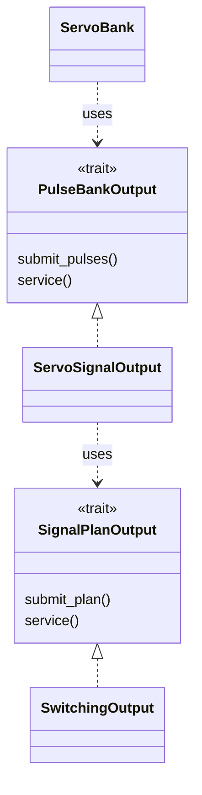
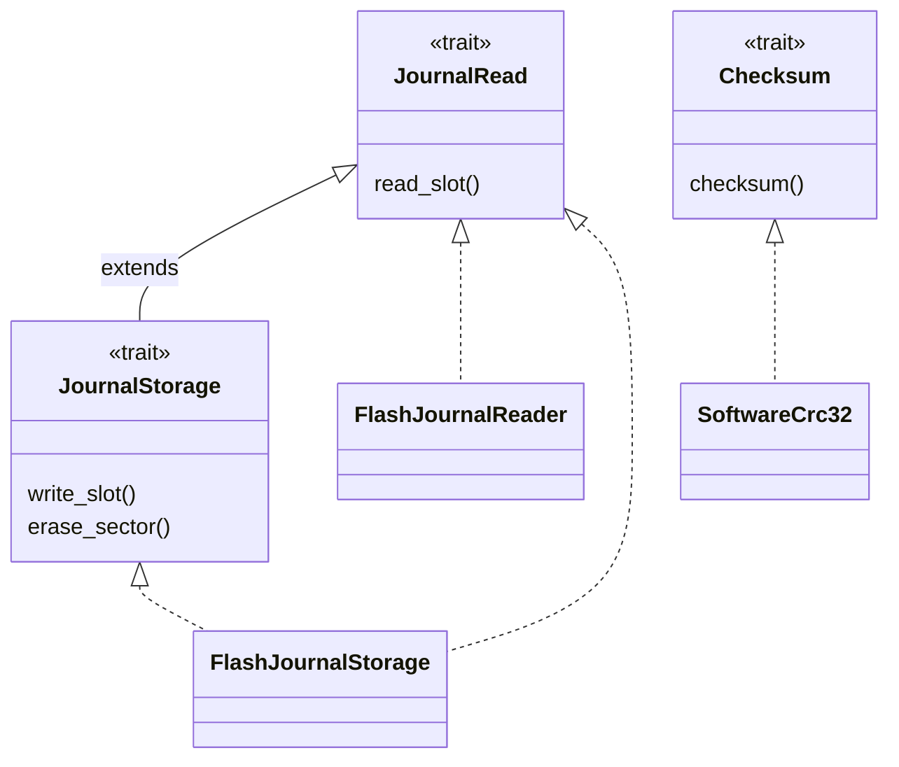
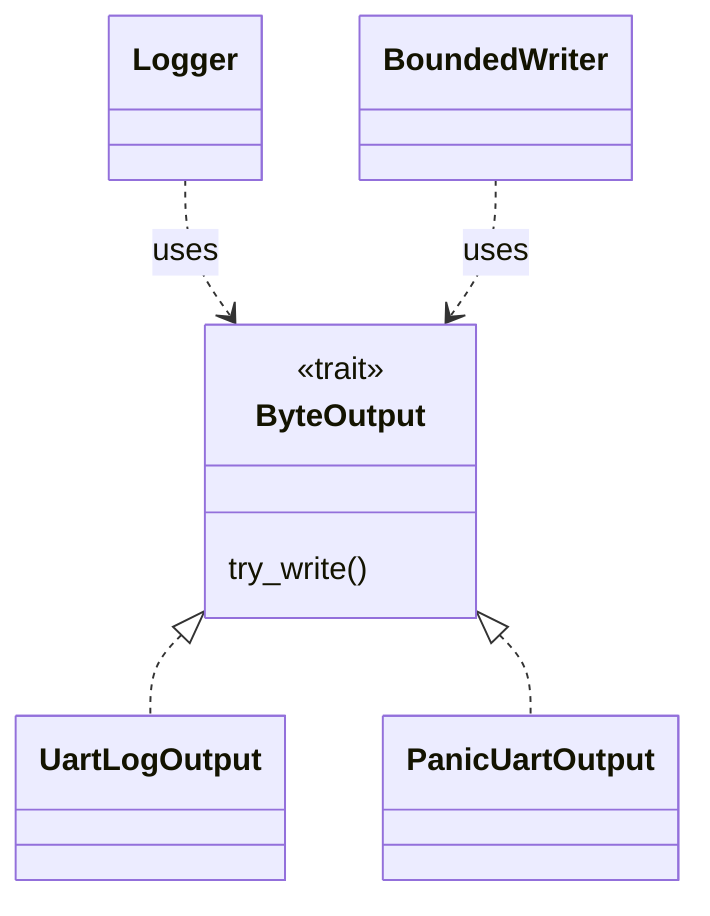
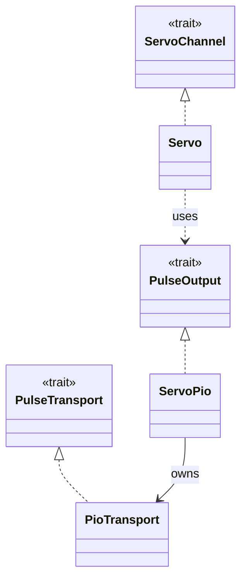
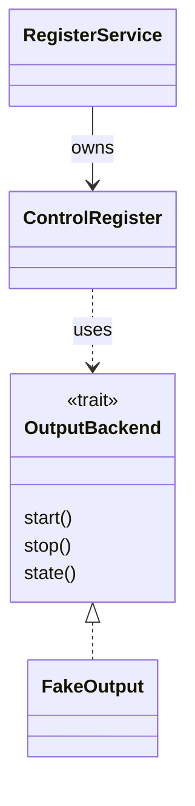

# Traits and implementations

[Architecture maps](README.md) · [Software layers](software-layers.md)

Generic parameters are omitted from the diagrams for readability. A dashed triangle arrow points from an implementation to its trait. A labelled dashed arrow means a consumer uses a trait. The tables link to the exact definitions; test doubles and ordinary derived traits such as Debug are omitted.

## Multi-servo command path

| Trait | Defined in | Concrete implementation | Consumer |
| --- | --- | --- | --- |
| PulseBankOutput | [servo-control/servo_bank.rs](../../firmware/servo-control/src/servo_bank.rs) | [ServoSignalOutput](../../firmware/servo-control/src/servo_signal_output.rs) | ServoBank |
| SignalPlanOutput | [servo-signal/signal_plan_output.rs](../../firmware/servo-signal/src/signal_plan_output.rs) | [SwitchingOutput](../../firmware/servo-pio/src/switching_output.rs) | ServoSignalOutput |

PulseBankOutput receives a complete slice of pulse widths in ServoId order. SignalPlanOutput receives a reference to a complete SignalPlan. These contracts distinguish angle control from GPIO mapping and the hardware backend. FixedOutput has inherent start/service behavior but does not implement SignalPlanOutput. PreparedOutput prepares hardware resources; it is not another trait implementation in this chain.

## Storage and CRC

| Contract | Implementation and use | Source |
| --- | --- | --- |
| JournalRead | FlashJournalReader and FlashJournalStorage implement reading; load consumes a JournalRead backend | [storage.rs](../../firmware/servo-storage/src/storage.rs), [flash_journal.rs](../../firmware/pico/src/flash_journal.rs), [journal.rs](../../firmware/servo-storage/src/journal.rs) |
| JournalStorage extends JournalRead | FlashJournalStorage implements the Pico backend; append consumes this contract | [storage.rs](../../firmware/servo-storage/src/storage.rs), [flash_journal_storage.rs](../../firmware/pico/src/flash_journal_storage.rs), [journal.rs](../../firmware/servo-storage/src/journal.rs) |
| Checksum | SoftwareCrc32 implements independent CRC-32/ISO-HDLC calculations; format, slots and journal operations accept the abstraction | [crc32.rs](../../firmware/servo-storage/src/crc32.rs), [format.rs](../../firmware/servo-storage/src/format.rs), [journal_slot.rs](../../firmware/servo-storage/src/journal_slot.rs) |

The RAM programming/erase functions are unsafe free functions. They do not implement JournalStorage themselves; FlashJournalStorage implements the trait and invokes them after validation. JournalLayout is a concrete geometry helper, not a storage trait. A Pico hardware CRC implementation is not present.

## Logging and panic output

| Contract or type | Role | Source |
| --- | --- | --- |
| ByteOutput | Immediately returns accepted/full/error for a byte | [logging/lib.rs](../../firmware/logging/src/lib.rs) |
| UartLogOutput implements ByteOutput | Pico UART backend for the normal buffered Logger path | [uart_logging.rs](../../firmware/pico/src/uart_logging.rs) |
| PanicUartOutput implements ByteOutput | Private direct UART backend used by the panic handler | [panic_uart.rs](../../firmware/pico/src/panic_uart.rs) |
| BoundedWriter implements core::fmt::Write | Formats diagnostic text with a bounded byte-output attempt budget | [bounded_writer.rs](../../firmware/logging/src/bounded_writer.rs) |

Logger queues whole messages and drains them through `service(byte_budget)`. Panic formatting uses a separate bounded direct-output path rather than relying on the application loop. The ByteOutput contract itself is nonblocking in both cases. Several isolated flash tests deliberately use panic_halt instead of the UART panic handler.

## Earlier single-servo path

[Servo and its traits](../../firmware/servo-control/src/servo.rs) remain in servo-control. The earlier [ServoPio/PioTransport driver](../../firmware/pico/src/drivers/servo_pio.rs) implements PulseOutput and PulseTransport respectively, using [submit_pulse](../../firmware/servo-signal/src/lib.rs). That driver file is retained in the repository but is not included by the current Pico main module tree. This is a historical single-output path, not the current multi-servo DMA backend. ServoBank does not contain a collection of Servo objects; it owns its own calibrations and a PulseBankOutput backend.

## HAL boundary

The private [SignalPlanDmaSource](../../firmware/servo-pio/src/signal_plan_dma_source.rs) implements the HAL's unsafe ReadTarget trait for a checked range in an owned static buffer. The transfer owns this source until completion or confirmed abort. This external trait boundary supports DMA memory safety; it is not an application command interface. Hardware types in servo-pio are compiled for ARM bare-metal targets, which is why the combined Rustdoc task selects thumbv6m-none-eabi.

## Register-service output backend

[OutputBackend](../../firmware/servo-registers/src/output.rs) is the application-level start/stop/state contract consumed by [ControlRegister](../../firmware/servo-registers/src/control.rs). Only the shared [FakeOutput](../../firmware/servo-registers/src/test_support.rs) implements it at present, in tests. It must report reliable Active/Inactive state after errors; invalid initial targets must leave output unchanged. No ServoBank, FixedOutput or SwitchingOutput adapter implements this new trait yet. [RegisterService](../../firmware/servo-registers/src/service.rs) owns ControlRegister and maps it to Control/Status plus LastError. These host-tested types are not wired into the normal Pico binary.
