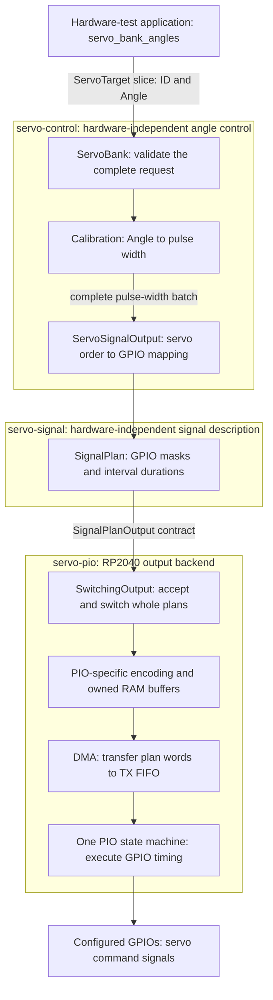
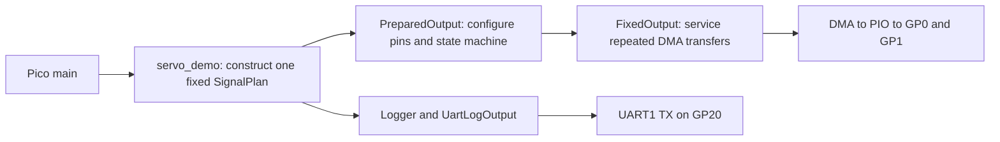
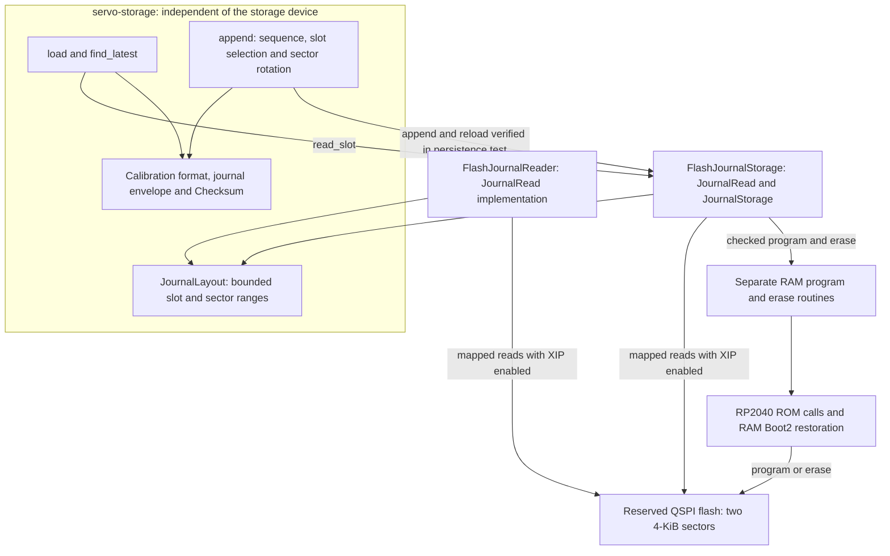

# Software layers

[Architecture maps](README.md) · [Traits and implementations](interfaces.md)

## Angle command to servo signal

This path is implemented and exercised by the separate [servo_bank_angles hardware test](../../firmware/pico/hardware_tests/servo_bank_angles.rs). Its calibrations are synthetic; the signal test does not establish measured servo positions. The normal firmware follows the shorter fixed-plan path below.

| Responsibility | Owner | Source |
| --- | --- | --- |
| Integer angle representation, in hundredths of a degree | Angle | [angle.rs](../../firmware/servo-control/src/angle.rs) |
| Two-point angle-to-pulse conversion and angle bounds | Calibration | [calibration.rs](../../firmware/servo-control/src/calibration.rs) |
| Servo IDs, complete-request validation, retained accepted targets | ServoBank | [servo_bank.rs](../../firmware/servo-control/src/servo_bank.rs) |
| GPIO assignment, signal limits and frame period | ServoSignalOutput | [servo_signal_output.rs](../../firmware/servo-control/src/servo_signal_output.rs) |
| Generic GPIO masks and durations, independent of PIO instructions | SignalPlan | [signal_plan.rs](../../firmware/servo-signal/src/signal_plan.rs) |
| PIO counter encoding and buffer representation | servo-pio internals | [encoding.rs](../../firmware/servo-pio/src/encoding.rs), [buffer.rs](../../firmware/servo-pio/src/buffer.rs) |
| Pending plan, DMA ownership, frame handover and persistent fault | SwitchingOutput | [switching_output.rs](../../firmware/servo-pio/src/switching_output.rs) |
| PIO assembly and timing | PIO program | [program.rs](../../firmware/servo-pio/src/program.rs) |

The first nonempty ServoBank request must initialize every configured servo. Later requests may update a subset. The bank validates the whole candidate, fills unchanged targets from previously accepted commands, and submits one complete batch. It commits its commanded-angle state only if the backend accepts the batch. These are software acceptance records, not position feedback or proof that a frame has already been activated.

The application must keep calling `bank.service()`. It delegates through ServoSignalOutput to SwitchingOutput; PIO provides timing while CPU servicing manages transfers and plan replacement. On underflow the PIO path goes Low, the driver latches the fault, and recovery requires an explicit restart. Protocol acknowledgement semantics are not implemented yet.

## What normal firmware currently runs

[main.rs](../../firmware/pico/src/main.rs) starts [servo_demo.rs](../../firmware/pico/src/servo_demo.rs). The demo constructs a fixed two-channel pulse plan and starts FixedOutput. It does not construct ServoBank, load calibration from flash, or receive a command protocol. PreparedOutput is the resource-preparation step used before starting an output driver, not a new application control layer. FixedOutput is not an implementation of SignalPlanOutput.

## Calibration persistence

The [storage library](../../firmware/servo-storage/README.md) already implements encoding, CRC validation, latest-record selection and append/sector rotation over storage traits. The [Pico reader](../../firmware/pico/src/flash_journal.rs) implements JournalRead. Separate [RAM routines](../../firmware/pico/src/flash_xip.rs) and manual hardware tests exercise slot programming and sector erasure. The [FlashJournalStorage backend](../../firmware/pico/src/flash_journal_storage.rs) now implements JournalRead and JournalStorage around those routines. Its isolated read/program/erase tests passed. The separate [flash_journal_persistence test](../../firmware/pico/hardware_tests/flash_journal_persistence.rs) now verifies append/load of a valid synthetic eighteen-servo record and loading it after restart without rewriting. Sector rotation on hardware remains pending. FlashJournalReader remains as a separate read-only type, but the flash_journal_read test now uses FlashJournalStorage.

A missing valid record is `Ok(None)`; that does not authorize normal operation. Loading a complete configuration, startup-mode enforcement, service invalidation and UART configuration transfer still need integration. A FlashJournalReader must not remain alive during program/erase or XIP reconfiguration.

## Package boundaries and future robot layers

| Cargo package | Architectural role |
| --- | --- |
| hexaroam-servo-control | Angle, calibration, single-servo commands, transactional bank and GPIO-mapping adapter |
| hexaroam-servo-signal | Generic pulse limits, signal plans and output contracts |
| hexaroam-servo-pio | RP2040-specific encoding, output resources, buffers, DMA/PIO and recovery |
| hexaroam-servo-storage | Calibration serialization, CRC abstraction, journal and storage geometry |
| hexaroam-logging | Buffered logging and bounded formatting over a byte-output contract |
| hexaroam-pico | Board setup, concrete UART/flash access, normal demo and separately registered hardware tests |

Behavior, navigation, gait generation, inverse kinematics and the command protocol remain future layers. They are not additional implemented boxes in the current command path. The [project design](../architecture.md) describes their intended roles.
