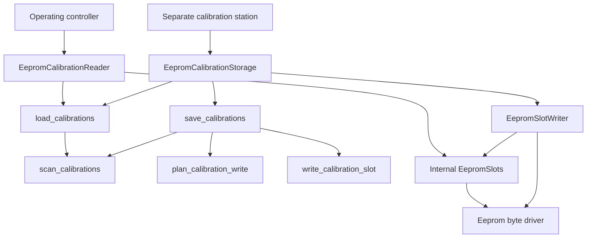

# EEPROM calibration storage

`hexaroam-servo-eeprom` connects the medium-independent calibration storage API to the 24xx256 byte driver. This separate `no_std` crate keeps the [EEPROM driver](../eeprom/README.md) independent of servo data and [servo-storage](../servo-storage/README.md) independent of I2C devices.

## Ownership and interfaces

| Type | Ownership and role |
| --- | --- |
| `EepromCalibrationReader<I, C, N, SLOTS = 64>` | Owns an EEPROM and checksum; implements only CalibrationRead for the operating controller |
| `EepromSlotWriter<I, D, SLOTS = 64>` | Owns the slot backend and DelayNs; implements JournalRead and SlotWrite |
| `EepromCalibrationStorage<I, D, C, N, SLOTS = 64>` | Owns the slot writer and checksum; implements CalibrationRead and CalibrationStorage for the separate station |

Construction checks the region without bus access. Zero slots and regions larger than the EEPROM are rejected. One-slot regions can be read, but saving requires at least two slots. Invalid servo counts are rejected when loading/saving before bus access.

The internal EepromSlots maps slot indices to byte addresses through SlotLayout. EepromSlotWriter additionally checks the relative byte range before writing; empty writes at offsets 0 through 512 perform no bus access. Writes cannot cross a logical slot boundary. Physical 64-byte page splitting and readiness polling are delegated to the byte driver.



## EEPROM layout

| Property | Value |
| --- | --- |
| Capacity | 32,768 bytes |
| Slot size | 512 bytes, eight 64-byte write pages |
| Default slot count | 64 |
| Slot address | index multiplied by 512 |
| Last slot | address 32,256 through 32,767 |
| Representation | Existing version-1 journal slot, unchanged |

Adapters can use a smaller nonempty region starting at zero. A slot holds up to 24 calibration entries in the existing format; all entries required by N must be present to load a complete dataset. Configuring N does not enlarge a slot. No active/validity flag was added.

## Loading and validation

scan_calibrations reads slots individually in ascending order, returning the newest format/CRC-valid record with its physical slot and u64 sequence. It retains one slot buffer, a latest candidate and a sequence-number table rather than the whole EEPROM image. Duplicate sequences among valid records are errors, including identical records and older duplicates. Invalid records are skipped; a storage read error aborts because the unreadable slot might contain newer data.

load_calibrations uses this scan and then checks completeness. An intact but incomplete newest record returns IncompleteCalibration with the first missing Servo ID, without falling back to older data. An empty valid record is therefore an error for N greater than zero, not None. No valid record returns None. Format checks cannot prove correct physical mounting or application-specific pulse limits.

## Saving and rotation

The station calls CalibrationStorage::save with a complete array. Initially identical data succeeds without programming or sequence increment, including at the maximum sequence. An incomplete latest record can be replaced. The first record uses slot zero and sequence one; changed data uses the next slot in the ring and the next sequence. Sequence overflow is an error.

Each attempt encodes before modifying storage, writes an invalid identifier and verifies it, writes the remaining body/CRC/padding, and restores the valid identifier last. Success requires an exact readback of all 512 bytes, including padding. No EEPROM sector erase is needed. The original newest valid slot remains protected throughout the call.

Only readable invalidation or final-content mismatches permit another attempt. Storage errors, including readiness timeouts, abort immediately. At most three distinct targets are tried; fewer may be available because protected and attempted slots are excluded. Before retrying, storage is rescanned, the newly highest valid slot is also avoided, and the next sequence exceeds both the scan result and the previous attempted sequence. The unchanged-data shortcut is not applied during retries.

A failed save is not a rollback guarantee. A transfer may partially modify a target; a readback mismatch or read error may occur after a new valid record exists. The original protected slot is preserved under the backend's range-write contract, but a later load still selects the newest valid record. In particular, padding is ignored by decoding even though exact write verification checks it. The station must report save errors and verify storage before handing it back to the robot. Faulty hardware changing bytes outside a requested range is outside that contract.

## Errors

EepromSlotError distinguishes invalid slot layout, relative-range errors and underlying EEPROM errors. The read-only reader returns CalibrationLoadError. The station adapter uses EepromCalibrationStorageError::Load or ::Save so read and persistence errors remain distinguishable. AttemptsExhausted retains the number of attempts and last verification error.

WP may acknowledge writes without storing data. The station's readback/invalidation checks must therefore succeed before save reports success; an ACK alone is insufficient. Existing tests cover a write-protected erased device. Real WP behavior has not yet been checked.

## Verification and remaining work

From the repository root:

```bash
cargo test --manifest-path firmware/servo-storage/Cargo.toml
cargo test --manifest-path firmware/servo-eeprom/Cargo.toml
python tools/dev.py fmt
python tools/dev.py verify
```

The owner reported 186 storage tests, 46 EEPROM adapter tests, then 837 tests and all 21 full local checks passing. Adapter coverage comprises the original 15 reader tests, 15 slot-writer tests and 16 station-storage tests. The end-to-end station tests use an in-memory I2C EEPROM model with the actual byte driver, format, scan, planner, write verification and storage traits. They cover round trips, reconstructed adapters, unchanged data, rotation, incomplete records, bus errors and simulated WP. Core tests cover retries, partial modifications, protected slots and sequence exhaustion. They do not verify physical EEPROM timing or power-loss behavior.

The package and Cargo.lock remain registered in test, fmt, check, verify and doc; no workflow change was needed. The owner reported CI green for the preceding reader revision; CI for this writer revision is pending.

No real EEPROM/Pico I2C hardware test has run. Boot/protocol integration and the PC-controlled programming/calibration-station application remain pending. The robot reads calibration at startup only; the station writes the detached EEPROM while the robot is unpowered. Existing flash journal tests remain separate.
